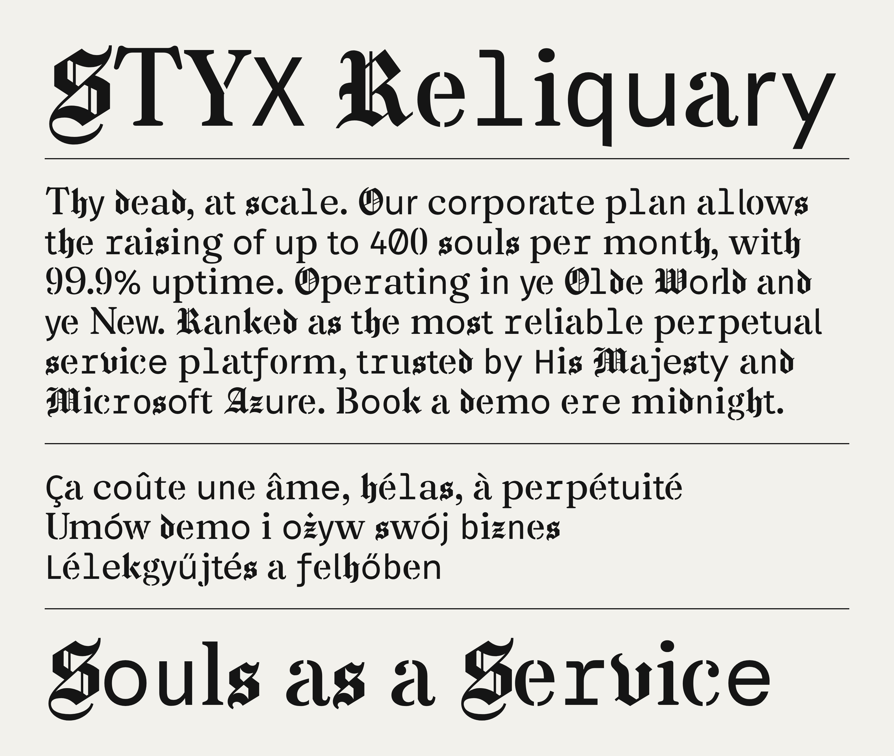

# STYX Reliquary

Font made by combining several open source fonts.



| Style       | Source                                                                             |
| ----------- | ---------------------------------------------------------------------------------- |
| Blackletter | [Manufacturing Consent](https://github.com/googlefonts/manufacturing-consent-font) |
| Serif       | [Fraunces](https://github.com/undercasetype/Fraunces)                              |
| Stencil     | [Stardos Stencil](https://fonts.google.com/specimen/Stardos+Stencil)               |
| Sans        | [Fira Sans](https://github.com/mozilla/Fira)                                       |
| Monospace   | [DM Mono](https://github.com/googlefonts/dm-mono)                                  |

## Build

```sh
pip install fontmake
fontmake -u sources/STYXReliquary-Regular.ufo -o ttf otf
```

## License

SIL Open Font License 1.1, see `OFL.txt`.
